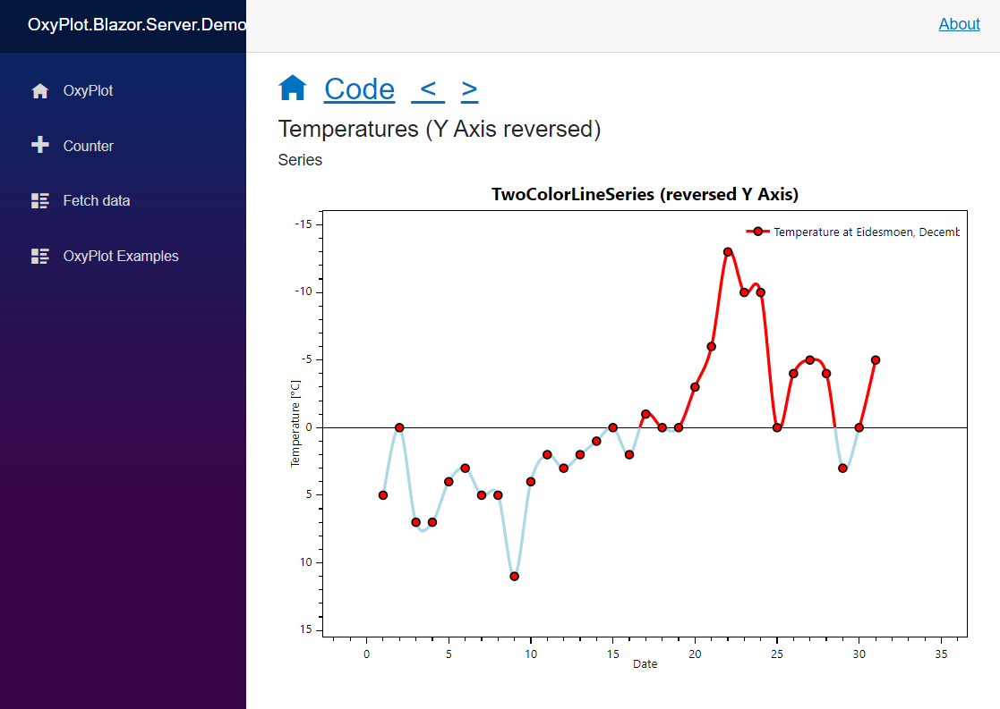

# OxyPlot.Blazor.BlazorPlotView Component



## Requirements

- dot net 8.0 / net 9.0 / net 10.0

## Usage

nuget package at https://www.nuget.org/packages/OxyPlot.Blazor/

Add Package Reference to OxyPlot.Core
Add `OxyPlot.Blazor` library

add OxyPlotServices in Program.cs 
```cs
var builder = WebApplication.CreateBuilder(args);

// Add services to the container.
builder.Services.AddRazorPages();
builder.Services.AddServerSideBlazor();
builder.Services.AddSingleton<WeatherForecastService>();
// add OxyPlot.Blazor scripting
builder.Services.AddOxyPlotBlazor();

var app = builder.Build();
```

```razor
@using OxyPlot.Blazor
<BlazorPlotView Width="100%" Height="30vh" Model="_model" />
@code {
	PlotModel _model = ... // some model
}
```

## Performance

The plot is rendered as SVG, every data point ends up in the DOM. Some tips for large data sets:

- Call `PlotModel.InvalidatePlot` after changing the model. Mouse events (tracker, zoom rectangle) do not render the plot again,
  only the overlay, so hovering and tracking stay fast even with many points.
- For line series with many more points than horizontal pixels, set `LineSeries.Decimator = Decimator.Decimate`.
  It keeps the minimum and maximum of each pixel column, the line looks the same, but the browser has far fewer points to draw.
- Use Blazor WebAssembly AOT compilation (`<RunAOTCompilation>true</RunAOTCompilation>`) for interactive plots with many points.
